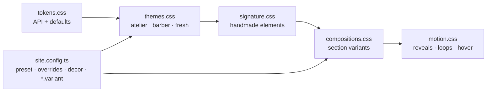

# DESIGN.md: art direction for the Vibranic starter kit

> Spec for **frontend** (what to build) and **Kilian** (what to change, and where).
> Living reference: **`/design`**. Every mockup there is built only from the kit classes below, so
> **its markup is the reference markup**. Copy it, then swap the demo text for `site.config.ts` values.



| Rule | Meaning |
|---|---|
| **New client = config swap** | Look = `theme.preset` + `theme.overrides` + `decor` + `*.variant`. No CSS per client. |
| **Tokens only** | Components never hardcode colour, size, radius, shadow or motion. |
| **One loud colour** | `--color-pop` is for **fills only** (buttons, stickers, marquee, hero bg). Never text on `--color-bg`. |
| **Decor is `aria-hidden`** | Doodles, stickers, the giant word, the side rail and the marquee copy are decoration. The real content (h1, prices, CTA) is always real text. |

---

## 1. Fresh: the flagship ("Studio Zine")

**Concept:** the salon's own little magazine. Warm paper with grain, ink-black type, **one acid-lime
highlighter**, and the stylist's notes in the margin (doodles, stickers, a stamp-like rotating badge).

**Distinctive decision:** **the width axis is the brand.** Anybody is a variable font with a
50–150% width axis. Headings run at 92% (readable, safe for Dutch compound words); the salon name
runs at **150% / 900** across the page like a shop sign. One family does both jobs, so there's no
second display font to download.

### Type

| Role | Face | Token(s) | Notes |
|---|---|---|---|
| Display / headings | **Anybody** variable (wdth + wght, ~57 KB latin) | `--font-display` `--display-stretch: 92%` `--font-display-weight: 800` | sentence case, `-0.03em` |
| Giant word | Anybody **150% / 900** | `--giant-*` | uppercase, leading 0.8 |
| Accent word (`<em>`) | **Instrument Serif italic** (~22 KB) | `--heading-em-font` | `Haar dat *bij jou* past` → serif italic inside the grotesk |
| Micro-labels, eyebrows | **DM Mono 500** (~15 KB) | `--font-mono` `--label-*` | uppercase, `0.14em` |
| Body | **Figtree** variable | `--font-body` | unchanged |
| Buttons | Anybody 112% / 800, uppercase | `--btn-*` | |

All self-hosted via @fontsource, `font-display: swap`, unicode-range split: only the latin file is
downloaded. Bricolage Grotesque (old Fresh) was removed.

### Palette + contrast (WCAG 2.1, measured)

| Token | Hex | Role | Pair → ratio |
|---|---|---|---|
| `--color-bg` | `#f2efe7` | paper | |
| `--color-surface` | `#fbfaf6` | card paper | ink 17.0 |
| `--color-surface-alt` | `#e6e8d9` | sage paper | ink 14.3 · muted 6.4 · accent 6.4 |
| `--color-text` / `--color-ink` | `#151912` | ink | on bg **15.5** |
| `--color-text-muted` | `#4d5347` | | on bg **6.9** |
| `--color-accent` | `#2d5b2a` | bottle green: links, eyebrows (text-safe) | on bg **6.9** · paper on it 6.9 |
| `--color-accent-hover` | `#224620` | | paper on it 9.3 |
| `--color-pop` | `#d4f03f` | **acid lime, fills only** | ink on it **13.9** · on bg 1.1 (never text) |
| `--color-pop-hover` | `#c3e02a` | | ink on it 11.9 |
| `--color-highlight` | `#e4f2a6` | pale lime badge | ink 14.9 |
| `--color-border-strong` | `#7a7f6e` | input borders | bg 3.6 · alt 3.3 (≥3) |
| `--color-error` | `#b0281c` | | on bg 5.8 |
| `--color-invert-bg` / `-text` | `#151912` / `#f2efe7` | ink band | **15.5** |
| `--color-invert-muted` | `#b9bdae` | | 9.3 |
| `--color-invert-accent` | `#d4f03f` | prices, links on ink | **13.9** |

Primary button = lime fill + ink text (13.9) + **2px ink border**, so the button edge is ≥3:1 on
paper (WCAG 1.4.11), even though lime-on-paper is only 1.1. Focus ring = bottle green, 3px, offset
3px (6.9 on paper). `/design` re-measures every pair live, so overrides are checked too.

### Shape, depth, texture
- Pills for buttons, 1.5rem cards with a **2px ink outline + lime offset shadow** (`--card-shadow`).
- **Hard shadows** (`--hard-shadow`, no blur) instead of soft ones: printed-sticker feel.
- Paper **grain** at 9% (`--grain-opacity`), **topo lines** on the ink band (`--texture-opacity: 0.14`).
- Leaf image shape kept from Fresh v1 (`--radius-feature`).

---

## 2. Config shape (frontend adds this to `app/types/site-config.ts`)

All new keys are **optional**; omitting them keeps today's layout. So existing configs keep working.

```ts
export type HeroVariant = 'split' | 'giant-type-cutout' | 'framed-card' | 'collage'
export type EdgeStyle = 'none' | 'torn' | 'wavy' | 'scallop'

export interface Cutout extends Image {
  /** photo = transparent PNG/WebP of a person/object (gets a soft contact shadow)
   *  illustration = transparent drawing with its own outlines (no shadow)
   *  shaped = a NORMAL photo, shown in a blob window (fallback when there's no cut-out) */
  kind: 'photo' | 'illustration' | 'shaped'
}

// SectionKey gains 'marquee'
export type SectionKey = 'hero' | 'marquee' | 'services' | 'about' | 'gallery' | 'reviews' | 'contact'

interface SiteConfig {
  // …existing…
  decor?: {
    /** Paper grain overlay. Default true (strength comes from the preset; 0 in atelier/barber). */
    grain?: boolean
    /** Edge between sections. Default 'none'. */
    edge?: EdgeStyle
    /** Rotating badge text. Default = booking.label. Keep it 12–24 characters; it repeats twice around the circle. */
    badgeText?: Text
    /** Badge link. Default = booking.href, else '#contact'. */
    badgeHref?: string
    /** Built-in doodles in the variants. Default true. */
    doodles?: boolean
    /** Mono micro-labels in the hero meta row. */
    meta?: { left?: Text; right?: Text; est?: string; coords?: string }
    /** Words for the marquee strip (section key 'marquee'). Default = service category + item names. */
    marquee?: Text[]
  }
  hero: {
    // …existing (eyebrow, title, subtitle, image, primaryCta, secondaryCta)…
    variant?: HeroVariant            // default 'split' (current hero)
    /** Giant word. Default = business.name. ≤ 10 letters looks best; 1 word. */
    giantText?: string
    /** Required for 'giant-type-cutout'. Without it that variant falls back to kind 'shaped' using hero.image. */
    cutout?: Cutout
    /** Up to 2 short sticker labels ("Nieuw", "Balayage-specialist"). */
    stickers?: Text[]
  }
  services: { /* … */ variant?: 'cards' | 'menu-board' }               // default 'cards'
  about: { /* … */ variant?: 'split' | 'torn-frame'; note?: Text }      // note = handwritten aside, e.g. 'dat zijn wij!'
  gallery: { /* … */ variant?: 'grid' | 'collage' }                     // default 'grid'
}
```

**Example: Studio Noor in full Fresh**
```ts
theme: { preset: 'fresh' },
decor: { edge: 'torn', badgeText: 'Maak een afspraak', meta: { left: 'Kapsalon — Hasselt', est: '2019' } },
sections: ['hero', 'marquee', 'services', 'about', 'gallery', 'reviews', 'contact'],
hero: { variant: 'giant-type-cutout', giantText: 'Noor', cutout: { src: '/images/noor-cutout.webp', kind: 'photo', alt: '…', width: 1400, height: 1600 }, stickers: ['Balayage-specialist'], /* … */ },
services: { variant: 'menu-board', /* … */ },
about: { variant: 'torn-frame', note: 'dat zijn wij!', /* … */ },
gallery: { variant: 'collage', /* … */ },
```

**vibranic.be:** `hero.variant: 'giant-type-cutout'`, `giantText: 'Vibranic'`,
`cutout: { src: '/images/brand/vibranic-character.png', kind: 'illustration', … }`. The pop colour
should come from the character (its yellow or sky blue) via `theme.overrides['--color-pop']`:
**hex to be confirmed by Kilian from the PSD.**

---

## 3. Signature elements (signature.css)

Each element is themed by tokens, so it changes with the preset. Markup below; see `/design` §05.

| # | Element | Class / markup | Tokens |
|---|---|---|---|
| 3.1 | **Rotating text badge** | `.spin-badge` (+`--pop`) → `svg.spin-badge__ring` with `<textPath>` + `.spin-badge__core` | `--spin-size` `--spin-duration` `--spin-font` |
| 3.2 | **Section edges** | `data-edge="torn\|wavy\|scallop"` on a `.section` (bites UP into the previous one); `data-edge-bottom` hangs down | `--edge-height` `--edge-tile`; colour = the section's own `--section-bg` |
| 3.3 | **Stickers** | `.sticker` (`--ink` `--paper` `--pill` `--right` `--vertical` `--stat`), `.sticker-burst > span`, `.sticker-letters > span×n`, `.tape` | `--sticker-*` `--outline-width` `--hard-shadow` |
| 3.4 | **Doodles** (9) | `<span class="doodle doodle--NAME" aria-hidden="true">` NAME = `arrow-curve` `arrow-loop` `sparkle` `sparkles` `underline` `swirl` `motion-lines` `scribble-circle` `dash-trail` (+`--flip`). In headings: `<em class="circled">` / `<em class="scribbled">` | `--doodle-color` `--doodle-size` |
| 3.5 | **Marquee** | `.marquee` (`--ink` `--tilt` `--reverse`) → `.marquee__track` → **two identical** `ul.marquee__group` (2nd `aria-hidden="true"`) | `--marquee-*` |
| 3.6 | **Grain / topo** | `.grain` on the page wrapper (fixed layer) or `.grain--local`; `.texture-topo` on a section | `--grain-opacity` `--texture-*` |
| 3.7 | **Micro-labels** | `.label-mono` (`--ink`), `.meta-row`, `.tag-est`, `.rail` (vertical, ≥56rem only, `aria-hidden`) | `--label-*` |
| 3.8 | **Dashed rules** | `.rule-dashed`, `.leader` (menu dots), preset `.divider` | `--dash-*` |
| 3.9 | **Giant type** | `.giant` (viewport scale `--text-giant`), `.giant--fit` inside `.fit-box`, `.giant--outline` | `--giant-*` |
| 3.10 | **Frames + cut-outs** | `.frame` (`--polaroid` + `.frame__caption`, `--torn`, `--flat`, `--right`), `.cutout` (`--photo`, `--shaped`) | `--frame-*` |
| 3.11 | **CTA pill** | `a.cta-pill` → label + `span.cta-pill__icon > span.icon-arrow` | button tokens |
| 3.12 | **Invert band** | `.section--invert` (or `.invert` on any box): re-maps the core colour tokens to ink | `--color-invert-*` |

**3.1 Badge markup** (id from `useId()`; `textLength="500"` = the circle's length, so any text fills it exactly):
```html
<a class="spin-badge" :href="badgeHref" :aria-label="badgeText">
  <svg class="spin-badge__ring" viewBox="0 0 200 200" aria-hidden="true">
    <defs><path :id="id" d="M100 100m-80 0a80 80 0 1 1 160 0a80 80 0 1 1-160 0"/></defs>
    <text><textPath :href="`#${id}`" textLength="500" lengthAdjust="spacing">{{ badgeText }} • {{ badgeText }} • </textPath></text>
  </svg>
  <span class="spin-badge__core" aria-hidden="true"><span class="icon-arrow icon-arrow--ne"></span></span>
</a>
```

**3.9 Fitting the giant word.** `.giant--fit` sets `font-size = 100cqi × 0.97 / (--chars × --giant-char)`.
`--chars` is the word's **weighted** letter count; frontend computes it at build time in a small util
(uppercase the word, sum the weights). Weights were measured on Anybody 150%/900 (word sums match
the real width within 1%):

| Weight | Letters |
|---|---|
| 0.5 | I 1 |
| 0.85 | F L |
| 0.93 | E |
| 1.03 | B C D J K P R S T Z + any digit/other |
| 1.1 | G H O Q U V X Y |
| 1.15 | A |
| 1.2 | N |
| 1.25 | & |
| 1.35 | M |
| 1.55 | W |
| 0.35 | space |

Examples: VIBRANIC 7.54 · NOOR 4.43 · FRESH 4.94. Set it as `style="--chars: 4.43"`.

---

## 4. Section variants (compositions.css)

Layer order everywhere: **giant word (z1) → subject/photo (z2) → copy, stickers, badge (z3)**.

### 4.1 `hero.variant: 'giant-type-cutout'` (Voldog). See `/design` A + A2
```
section.section.hero-giant           ← bg = --hero-bg (default pop), text = ink
  .container.container--wide.hero-giant__inner  style="--chars: N"   ← container for the cqi maths
    .meta-row.label-mono.hero-giant__meta     (decor.meta: left · coords · "Est. 2019")
    .hero-giant__stage                        (grid stack)
      p.giant.hero-giant__word  aria-hidden  data-intro          ← giantText
      .cutout.cutout--{photo|illustration|shaped}.hero-giant__cutout  data-intro style="--intro-delay:120ms"
        <NuxtImg …cutout  loading="eager" fetchpriority="high" format="webp">
      span.doodle.decor ×1–2  (motion-lines near the subject, sparkles)   if decor.doodles
      span.sticker.decor      (hero.stickers[0]; hide below 40rem)
      a.spin-badge.hero-giant__badge
    .hero-giant__copy
      h1.h1  (hero.title, richText → <em>)
      p      (hero.subtitle)
      .cluster → a.btn.btn--primary + a.btn.btn--secondary
```
- The subject starts at `--cutout-overlap` (default 0.5) of the letter height, so it stands **in
  front of** the lower half of the word. Optional per site: `--cutout-width`, `--cutout-align: start|center|end`.
- **Mobile (<56rem):** stage (word + subject + badge) on top, copy below in normal flow. **Desktop:**
  copy overlays the bottom-left, badge bottom-right.
- On the pop background the primary button flips to **ink with a lime label** automatically.
- **Works with:** a transparent photo (`kind: 'photo'`, soft contact shadow), an illustration
  (`'illustration'`, no shadow), or a normal photo (`'shaped'`, blob window, see A2).

### 4.2 `hero.variant: 'framed-card'` (Voldog card). See `/design` B
```
div.hero-card
  .hero-card__frame.invert                     ← rounded card, ink fallback bg
    .hero-card__media > NuxtImg (hero.image, eager)   ← scrim via ::after keeps text ≥4.5:1
    .hero-card__top     → SiteHeader in **overlay mode** (brand · nav · CTA), see 4.6
    .fit-box.hero-card__word > p.giant.giant--fit aria-hidden    (giantText; optional cutout can sit here too)
    .hero-card__bottom
      .hero-card__copy → span.eyebrow · h1.h1 · a.cta-pill (secondaryCta or primaryCta)
      a.spin-badge.spin-badge--pop.hero-card__badge
```

### 4.3 `hero.variant: 'collage'` (Marutomo). See `/design` C
```
section.section.hero-collage > .container.container--wide.hero-collage__inner
  h1.hero-collage__title.giant--outline   (hero.title; <em> turns lime) ← keep ≤ 4 short words
  .hero-collage__media
    .frame.hero-collage__frame > NuxtImg (hero.image)
    span.sticker.sticker--vertical.sticker--ink.hero-collage__vsticker  (hero.eyebrow)
    span.hero-collage__letters > span.sticker-letters[aria-hidden] > span×letters + span.sr-only(word)  (hero.stickers[0])
  .hero-collage__copy → p.lead · .cluster(btn--primary.btn--lg + btn--ghost) · span.doodle.doodle--arrow-loop.hero-collage__arrow
```

### 4.4 `services.variant: 'menu-board'`. See `/design` 02
`section.section.section--invert.texture-topo[data-edge]` → `.menu-board__head` (eyebrow + h2 | intro)
→ `.menu-board__cols` → per category `.menu-board__cat` → `h3.menu-board__cat-title > span.sticker`
→ `ul.menu-board__list > li.menu-row` = `span.menu-row__name` · `span.leader[aria-hidden]` ·
`span.menu-row__price` (`<small>vanaf</small>` when `priceFrom`, then the formatted price) ·
`span.menu-row__meta.label-mono` (duration · description). 1 column on mobile, 2 from 56rem.
Categories alternate sticker tilt automatically.

### 4.5 `about.variant: 'torn-frame'` and `gallery.variant: 'collage'`. See `/design` 03 + 04
- **About:** `.about-torn__grid` → text column (eyebrow, h2 with optional `<em class="scribbled">`,
  paragraphs, `p.about-torn__note[aria-hidden]` = `about.note` + `doodle--arrow-curve`) and
  `.about-torn__media` (`span.tape.about-torn__tape`, `.frame.frame--torn.about-torn__photo > img`,
  `ul.about-torn__stats > li.sticker.sticker--stat` ×highlights: `strong` value + `span.label-mono` label;
  every 2nd gets `sticker--paper`).
- **Gallery:** `ul.gallery-collage > li > .frame > img`. Mobile: clean 2-column grid, no tilt. Desktop:
  the first **6** are scattered with overlaps + tilt; images 7+ go in a normal `.grid` after the list.
  Hover/focus lifts a frame to the front and straightens it.

### 4.6 Shared rules for frontend
- **Edges:** if `decor.edge !== 'none'`, every section **after the first** gets `data-edge="{edge}"`.
  The edge takes the colour of its own section, so the order of backgrounds decides what you see.
  Suggested Fresh order: hero (pop) → marquee `--ink` → services `--invert` → about (bg) →
  gallery `--alt` → reviews (bg) → contact `--alt`.
- **Grain:** `class="grain"` on the page wrapper when `decor.grain !== false`.
- **Marquee section** (`'marquee'` key): `.marquee.marquee--ink` (or `--tilt`) with `decor.marquee`
  items, a `doodle--sparkle` `<li aria-hidden>` between items, and the group duplicated with `aria-hidden`.
- **SiteHeader overlay mode** (framed-card only): transparent, inside `.hero-card__top`, paper text,
  existing mobile menu button + panel unchanged. Other variants keep the normal sticky header.
- **Hero images:** the cut-out/hero image is the LCP element: `loading="eager" fetchpriority="high"
  preload`, `format="webp"`, `sizes="xs:90vw md:45vw"` for the cut-out.
- `.decor` items get `--x --y --r` inline; keep them off the copy column, hide stickers below 40rem
  if they collide.

---

## 5. Motion (motion.css): CSS only, no library

| What | How | Reduced motion |
|---|---|---|
| **Scroll reveal** | `data-reveal` = `up` (default) · `pop` (stickers) · `tilt` (frames) · `wipe` (images). Native `animation-timeline: view()` (Chrome/Edge, Safari 26). | none, shown immediately |
| Fallback | frontend adds `app/composables/useReveal.ts`, called once in `app.vue` on mount: **if** `CSS.supports('animation-timeline: view()')` is false **and** reduced motion is off → add `reveal-ready` to `<html>`, then an IntersectionObserver (`threshold: 0.15`, `rootMargin: '0px 0px -10% 0px'`) adds `.is-revealed` to each `[data-reveal]` and unobserves it. Stagger with `style="--reveal-delay: {i*60}ms"`. No JS → everything visible. | not loaded |
| **Hero intro** | `data-intro` on the giant word and the cut-out (`--intro-delay`, `--intro-distance`). **Transform-only**, so the LCP element is never invisible. | none |
| **Badge** | ring spins in `--spin-duration` (18s); pauses on hover/focus, core arrow turns 45° with a spring | static |
| **Marquee** | `--marquee-duration` (28s) loop, `--reverse` option, pauses on hover | static (first set of words visible) |
| **Hover** | primary button lifts (`--btn-lift`) and presses into its hard shadow on click; stickers straighten + grow; frames straighten; `.link-draw` underline draws in; CTA-pill arrow nudges right | none |

**Where to put `data-reveal`:** section heads (`up`), menu rows / cards / reviews (`up` + stagger),
sticker **wrappers** (`pop`), frame **wrappers** (`tilt`). ⚠ Put `pop`/`tilt` on a wrapper, not on
the `.sticker`/`.frame` itself, because the animation would lock its `rotate` and kill the hover.
Never on the hero (it uses `data-intro`).

---

## 6. Performance budget (mobile Lighthouse ≥ 95)

| Asset | Size | Note |
|---|---|---|
| Fresh fonts (latin) | Anybody 57 KB + Figtree ~25 KB + Instrument Serif 22 KB + DM Mono 15 KB | swap; optional: preload Anybody latin |
| Kit SVGs | 0.1–1.2 KB each, topo 9 KB (≈3 KB gzip) | used as CSS masks, cached |
| Grain | 0.4 KB SVG tile | one fixed layer |
| Character PNG | 550 px | **too small for a full-bleed hero on 2× screens, see below** |

---

## 7. Atelier and barber: next round (not upgraded yet)

Both already get every element above through their tokens (pop = their accent). To give each its
own **concept** later, only the preset block in `themes.css` changes (plus maybe one new edge SVG):

| Preset | Concept to build | Token moves |
|---|---|---|
| **Atelier** | *"Fitting Room"*: the Vogue mood board. Bodoni italic giant name, arch-mirror cut-outs, polaroids with serif captions, scallop edges, blush sticker tape. | `--giant-font: var(--font-accent)` italic, `--giant-transform: none`, `--color-pop: blush`, `--sticker-radius: pill`, `--hard-shadow: none` → soft shadow, `decor.edge: 'scallop'` |
| **Barber** | *"Chicago Sign Shop"*: enamel shop signs. Condensed giant name, invert band as the default, brass enamel badges, zig-zag ticket edges, barber-pole marquee, halftone instead of topo. | `--giant-char: 0.52`, `--color-pop: brass`, `--sticker-radius: 0`, new `edges/zigzag.svg`, `--marquee-bg: pole stripes` |

---

## 8. Open questions for Kilian
1. **Character export:** a **≥1400 px tall** transparent WebP/PNG of the Vibranic character (from the PSD), ideally **uncropped** (full figure) plus the current bust crop.
2. **vibranic.be pop colour:** the character's yellow or its sky blue? Send the exact hex from the PSD.
3. **Fresh's lime:** `#d4f03f` is the loudest choice. If it's too much for salons, the calm alternative is a soft coral, swapped in one token (`--color-pop`).
